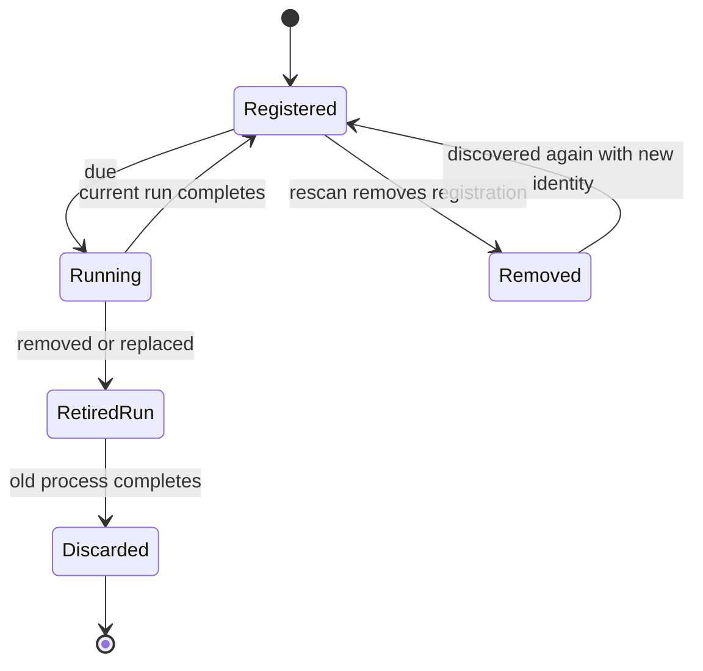

# Eave architecture

Eave has one application process and three ownership boundaries. The existing structure is sufficient for local script execution and native presentation.

| Boundary | Owns | Does not own |
|---|---|---|
| `Sources/EaveCore` | Script values, discovery, execution, scheduling and pure plans/geometry | AppKit views or status items |
| `Sources/EaveKit` | AppKit/SwiftUI adapters for menus, hiding, overflow, permissions and Touch Bar | Plugin registration policy |
| `Eave` | App startup, AppState composition, filesystem watching and Settings | A second scheduler or parser |

EaveCore is AppKit-free. It is not entirely pure: discovery uses the filesystem and ScriptRunner starts processes. Its planners operate on plain values and can be tested independently.

## Script execution

```mermaid
sequenceDiagram
    participant Files as Plugin directory
    participant App as AppState
    participant Scheduler as PluginScheduler actor
    participant Runner as ScriptRunner
    participant UI as Native presenters
    Files->>App: Directory change
    App->>App: Discover and reconcile registrations
    App->>Scheduler: Update registered plugins
    App->>Scheduler: Tick
    Scheduler->>Runner: Execute due plugin with run ticket
    Runner-->>Scheduler: Output and exit result
    Scheduler->>Scheduler: Record completion time; validate ticket
    Scheduler-->>App: Current delivery token and outcome
    App->>App: Check shared delivery token after main-actor hop
    App->>UI: Apply current result
```

`PluginDiscovery` reads executable, non-hidden files and derives namespaces/refresh intervals. Duplicate namespaces are reported. Missing or invalid interval suffixes use the default interval; overflowing interval values no longer trap. `SchedulePlanner` decides which plugins are due. `PluginScheduler` owns registration identity, in-flight exclusion and diagnostic results. A removed/replaced registration retires its old result; bookkeeping remains distinct from whether its process has actually exited.

`ScriptRunner` invokes a local process and returns capped output. `ScriptOutput` chooses the small JSON payload or xbar-style parser. Consumers receive `ScriptItem` values rather than making the format decision again. Full xbar action compatibility is outside the implemented contract.

## Registration and run state



This diagram describes logical ownership, not an operating-system process state machine. Dropping a registration does not prove the old process stopped. A run ticket prevents an obsolete completion from clearing a newer run's state. AppState rechecks validity after asynchronous delivery before updating native presentation.

AppState also reconciles removed namespaces in renderer caches, failure state, Touch Bar items and overflow planning. A failed scan keeps usable previous state and exposes an error; it does not falsely become an empty folder.

## Native presentation

`MenuBarRenderer` maps namespaces to status items and creates supported menus. Deterministic namespace iteration is a logical order; it is not proof of the screen position chosen by macOS.

`HiddenSectionController` applies `HidePlan` through a separator and the optional item-movement adapter. `PermissionStore` queries current OS permissions. Basic hiding and ordinary script execution do not require every permission the app can inspect.

`NotchTrayModel` calculates kept/overflowed items. `NotchPanelGeometry` calculates a bounded frame with an explicit nonnotched case. `NotchPanel` maps that geometry to an AppKit panel and updates open content. The panel is informational in this delivery.

`TouchBarPresenter` maps current plugin items to a Touch Bar attached to Settings. `Eave/Settings` owns user-facing controls, selection and diagnostics. Visibility controls refresh work so a closed Settings window does not continue reloading its table.

## Storage, security and limits

There is no application database or cloud service. The plugin directory is local. The runner executes scripts with the user's privileges, so installed scripts are trusted code. The output-return cap is separate from temporary disk growth and descendant process lifetime. Those limits require the next runner work described in [the plan](docs/plans/2026-10-24-polish-and-next-development.md).

Brand colors live in assets; native UI colors remain semantic AppKit values. [DESIGN.md](DESIGN.md) defines the distinction.

## Verification boundaries

SwiftPM tests cover core/adapter behavior and available application fixtures. Tests that require a usable native session must be identified explicitly. Compiling the package or application sources does not verify status-item behavior, display geometry, keyboard access or Touch Bar hardware.

The [baseline audit](docs/audit-baseline.md) records source coverage and reproduced defects. [Verification](docs/verification.md) records final results and runtime limitations. The [next-development plan](docs/plans/2026-10-24-polish-and-next-development.md) separates future preferences/actions from current behavior.
