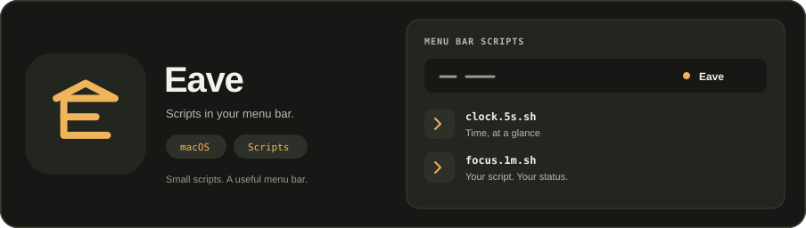

<p align="center">
  
</p>

#  Eave

Eave is a native macOS menu bar app for local scripts. It reads executable scripts from `~/.eave/plugins`, runs them on their filename interval and displays their output. Settings exposes script status and diagnostics, menu bar hiding, an overflow list for items that did not fit, and a Settings-scoped Touch Bar presenter.

Requires macOS 14 or later and Swift 6. The application uses AppKit and has no external package dependencies.

## Run from source

```sh
swift test
xcodegen generate
open Eave.xcodeproj
```

Choose the Eave scheme and run the app. The menu bar icon opens Settings, Scripts Folder and other available app actions. The repository does not provide a signed release or distribution setup.

## Add a script

Open **Settings → Scripts → Open Scripts Folder**. Place an executable script in that folder. A filename such as `clock.5s.sh` requests a five-second interval; `weather.5m.sh` requests five minutes. Eave discovers executable non-hidden files and reports rejected registrations in Settings.

A minimal script can print a status line and a menu link:

```sh
#!/bin/sh
printf 'Ready\n---\nProject website | href=https://example.com\n'
```

Make the file executable with `chmod +x`. Only install scripts you trust; scripts run as your user. This application is not a sandbox for untrusted code.

## Current behavior

- Script output supports the implemented xbar-style text subset and a small JSON title/image payload. It is not full xbar compatibility.
- Menu children can open supported `href` links. `bash=` is not executed. Top-level rendering uses the first item's title and optional image.
- Deleted registrations are removed from app presentation. Results from retired runs are rejected.
- Basic menu bar hiding uses a separator. Accessibility enables the implemented movement path; ordinary scripts do not require it.
- Overflow lists live items that did not fit in the menu bar. Rows with a supported link can open it. Other actions stay inert.
- The Scripts pane can run the selected script once with **Run now**, outside its interval.
- Hide collapsed state and Touch Bar enabled state persist locally with a schema version. Unknown or newer schema versions fall back to defaults.
- Touch Bar presentation is attached to Eave Settings. It is not a global Touch Bar replacement.
- `ScriptRunner` uses a wall-clock timeout (default 5 seconds). On timeout or stop it signals the child process group only when `getpgid` shows the child is the group leader.
- Returned stdout and stderr are capped separately from on-disk output while a script runs (defaults 1 MiB returned and 8 MiB per stream on disk). Polls truncate streams past the generated cap. A stream that grows 16 times the cap between two polls is treated as runaway and the run stops.

## Development references

- [Architecture](ARCHITECTURE.md) explains discovery, scheduling and native ownership.
- [Design system](DESIGN.md) defines layout, theme, interaction and motion rules.
- [Audit baseline](docs/audit-baseline.md) records reproduced issues and full-read coverage before this work.
- [Verification](docs/verification.md) records checks and outstanding runtime acceptance.
- [Development plan](docs/plans/2026-10-24-polish-and-next-development.md) details manual refresh, local preferences and actionable overflow.
- [Brand kit](assets/kit/preview_sheet_lite.html) includes concepts, original marks and platform/social exports. The banner is an illustration, not an app screenshot. A [static banner](assets/logo.svg) is also available.

## License

No license has been selected in this repository.
