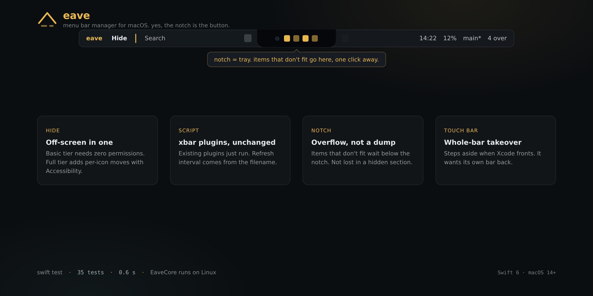

# Eave

<p align="center"></p>

A menu bar manager for macOS. **There is no app yet.** This repo is the library
underneath one: plugin discovery, a script runner, two output parsers, and the
geometry the UI will need.

What works today: point it at a folder of xbar plugins, run them on their own
intervals, get parsed menu items back. What does not exist: any window, any
status item, any of the four tools described below.

```sh
swift test        # 59 tests, about 0.6 s, on macOS and Linux
```

## Planned tools

These are the plan, not the state.

**Hide.** Squeeze icons left of a separator off-screen. Two permission tiers: a
basic tier that needs no permissions, and a full tier that needs Accessibility
to move individual icons.

**Script.** Run existing xbar plugins unchanged. The refresh interval comes
from the filename (`clock.5s.sh`). MTMR's JSON output (`{"title":"..."}`) works
too. This is the part with real code behind it.

**Notch.** Notched Macs run out of menu bar space with more than a few icons.
Eave will put the overflow in a panel below the notch instead of dumping it in
a hidden section.

**Touch Bar.** Take over the entire bar with your items, and step aside when a
blacklisted app is in front.

## What the library does now

```
Sources/EaveCore/
  Model/ScriptItem.swift          items, actions, refresh interval
  Script/ScriptRunner.swift       run a plugin, 5 s timeout, 1 MB output cap
  Script/XbarParser.swift         xbar line format, nested submenus
  Script/JSONOutputParser.swift   MTMR JSON shape, with plain-text fallback
  Script/Plugin.swift             scan a folder, read interval from the name
  Script/SchedulePlanner.swift    decide what is due, clock passed in
  Script/PluginScheduler.swift    run due plugins, coalesce, deliver results
  Geometry/SeparatorWidth.swift   the 10,000 pt clamp
  Geometry/NotchGeometry.swift    notch size from the auxiliary areas
```

`EaveCore` holds no AppKit code, by rule. Anything that draws will live in
`EaveKit`, which does not exist. The split keeps the part that changes most
testable in half a second on any machine.

```swift
let plugins = try PluginDiscovery.scan(directory: "~/.eave/plugins")
let scheduler = PluginScheduler { plugin, result in
    // Result<[ScriptItem], Error> for one plugin.
}
scheduler.tick(plugins: plugins)
```

## Design notes

The plans came from reading the source of seven related projects: Ice, Thaw,
hidden, boring.notch, MTMR, xbar, Pock. Three findings worth knowing:

1. **`NSStatusItem.length` caps at 10,000 pt.** Inflating one item pushes the
   rest off-screen: widest screen times two, clamped to that cap.
2. **Menu bar items live on window layer 25.** `CGWindowListCopyWindowInfo`
   plus that filter enumerates them without Accessibility.
3. **Moving icons takes synthetic CGEvents.** A command-drag names the target
   window through the private event field `0x33`, starting at `(20000, 20000)`
   so the user's cursor never moves.

One more, from writing the runner: catching stdout through a `Pipe` hangs when
the script spawns a child, because the grandchild holds the write end. Output
goes to a temp file and the process group gets the signal.

## License

Undecided, on purpose. GPL would block an App Store build later, and the
separator trick does work under App Store rules. The decision waits for the
store decision.
