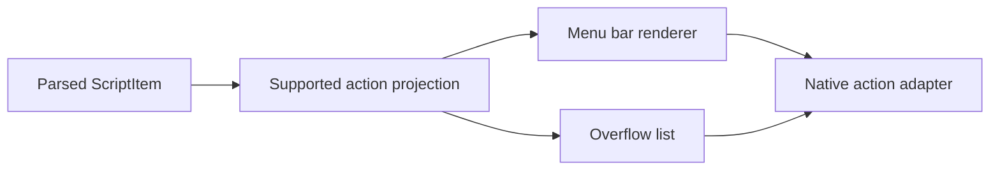

# Eave polish and next development

This plan preserves Swift 6, macOS 14, AppKit, EaveCore and EaveKit. The next system remains a local menu bar app. No database, account, network service, plugin marketplace or framework migration is proposed.

## Evidence and design decision

The [baseline audit](../audit-baseline.md) read every tracked source file and reproduced interval overflow, obsolete plugin delivery and incorrect completion timestamps. Its 98 passing tests did not cover those interactions. The real UI uses native adaptive colors. The old README banner was an illustration of capabilities that were not all connected to the app.

Two independent proposals compared native settings layouts and lifecycle ownership. Candidate A was selected. The independent judge scored A 22/25 and B 21/25 for this task; those are proposal scores, not product quality metrics. The synthesis keeps the existing scheduler API where practical, adds registration/run identity internally, and uses a second validity check before main-actor rendering. B's compact native inspector dimensions were adopted. Full output-process supervision was removed from the first wave because it needs its own process lifecycle design.

The Model the Domain principle changes the lifecycle design: current registration and in-flight execution have distinct identities. Prove It Works changes the acceptance bar: passing library tests cannot establish that the native settings window works.

## First delivery contract

| Area | Required behavior | Verification |
|---|---|---|
| Discovery | Overflowing interval values are rejected by the parser without a trap; discovery falls back to its default interval; failed scans differ from an empty folder | Boundary tests; source and UI-state review |
| Scheduling | Run completion is timestamped after execution; retired work cannot render or clear a later run | Controlled remove, replace and re-add fixtures |
| Presentation | Deleting a script removes its menu, Touch Bar and overflow state | Reconciliation checks and app integration |
| Scripts | Folder access, useful empty state, readable status, retained selection and selected diagnostics | App compilation; native acceptance matrix below |
| Overflow | List sits below the menu bar, fits the chosen display and updates while open | Pure geometry tests plus native inspection |
| Touch Bar | Existing presenter attaches to Settings; copy states its actual scope | App compilation and hardware acceptance |
| Identity | Original mark, static and animated SVGs, platform assets and brand brief | SVG audit, raster inspection and kit validation |
| Documentation | Current capabilities and output limits match source | Independent final review |

The current delivery status and exact check results belong in [verification](../verification.md). Future slices below are proposals, not shipped behavior.

## Native design specification

Use a 680 × 480 point initial settings window, with a 600 × 420 minimum. Keep four native tabs. Use 20-point outer spacing, 8-point related-control spacing and 16-point section spacing. Use system fonts at 17 points for headings, 13 for body/table text and 11 for secondary metadata. Tables use 32-point rows.

Scripts has a folder action and selectable path above a three-column table. Name flexes; Interval uses 72 points and Status 180. A 112-point diagnostic area shows the selected script's last result and capped, selectable stderr. Empty, scanning, failed scan, waiting, running, succeeded and failed states must derive from real state. Long names may truncate in the table but must remain available in the selected detail.

Use native semantic colors and focus rings. Amber belongs to brand assets, not a forced application theme. Errors use text and a symbol as well as color. No decorative entrance motion. Optional panel opacity transitions must finish within 120 ms and disappear under Reduce Motion.

The overflow list is informational in this delivery. It does not move unrelated applications' status items or claim to run arbitrary xbar actions. Target width is 280 points, maximum height 360, with an 8-point display margin and scrolling for longer lists.

## Next 0: Bound script output and child lifetime

This is the next reliability task before broader plugin distribution. The current returned-output cap is not a disk-growth limit. A trusted script can still produce excessive temporary output while it runs.

Proposed owner: `Sources/EaveCore/Script/ScriptRunner.swift`. Keep the public result independent of AppKit. Add a bounded outcome such as `outputLimitExceeded(stream:)` only after deciding whether the runner terminates or drains/discards excess output. Prefer draining with fixed memory bounds; prove both stdout and stderr cannot deadlock each other.

Tasks:

1. Reproduce flooding stdout, flooding stderr, simultaneous streams, a hanging child and a descendant retaining a pipe.
2. Compare bounded pipe draining with monitored temporary files. Choose using actual termination and memory/disk evidence.
3. Define maximum returned bytes, maximum generated bytes, timeout, cancellation and child cleanup separately. Do not use one ambiguous “1 MB cap” for all five.
4. Verify process-group setup before signaling a process group. Never infer group membership from a PID.
5. Update `ScriptOutcome`, diagnostics and Settings text only after the runner contract is settled.
6. Keep fixture cleanup even after timeout or assertion failure.

Acceptance: every fixture finishes within its test deadline; memory and temporary disk use obey the declared bound; no child remains; partial diagnostics identify truncation and the actual exit reason. A failing test must not affect installed user scripts. This phase needs process tests on supported macOS versions.

Rollback: retain the previous runner behind the unchanged public call while the replacement is isolated. Do not ship a partially wired cancellation path.

## Next 1: Run a selected script now

User outcome: refresh one script from Settings without waiting for its interval.

Keep scheduling in `PluginScheduler`. Proposed command:

```swift
enum RunRequestResult: Sendable {
    case queued
    case alreadyRunning
    case unavailable
}
func requestRun(pluginID: String) -> RunRequestResult
```

The command uses the same registration and run-ticket rules as scheduled work. A manual request must not create a parallel execution or revive a removed script. Complete this after lifecycle repairs pass. Do not add a shell command editor.

UI: a trailing **Run now** button in selected diagnostics. It is disabled while the selected script runs. Show “Already running” when appropriate; do not reset diagnostic content to a spinner. Keyboard activation uses native button semantics. Keep focus on the trigger after completion and announce the result once.

Implementation units:

1. Add the actor command and tests for repeated requests, removed scripts and interval reset after completion.
2. Connect the selected-script action in AppState and ScriptsPane.
3. Expose an optional script menu action only after the Settings path works.
4. Update supported behavior and verify that the timer still schedules other plugins.

Acceptance: two immediate clicks yield one process; removing the script while queued produces no result in the UI; manual and scheduled runs use identical parsing/error behavior. No new table, network call or permission is needed.

## Next 2: Persist deliberate local preferences

User outcome: Hide and Touch Bar choices survive restart, with safe defaults when stored data is invalid.

Keep persistence in the application. Proposed value:

```swift
struct AppPreferences: Codable, Equatable {
    var schemaVersion: Int
    var hiddenSectionCollapsed: Bool
    var touchBarEnabled: Bool
}
```

Use a small `UserDefaults` adapter injected into AppState; EaveCore does not need a preferences service. Do not store diagnostics, script output, file access grants or permission claims in these preferences. Never persist “Accessibility granted” as truth; query the operating system.

Tasks: define defaults and schema handling; load once during app startup; save after confirmed control changes; handle corrupt/unknown versions by falling back visibly and safely; test relaunch with an isolated defaults suite. Do not write tests against the user's standard defaults.

UI: no new preference page. Existing controls retain their positions. An error saving preferences keeps the current session state and explains that it may not survive restart. No animation is needed.

Acceptance: fresh launch, relaunch, corrupt storage and future schema are covered. Reset affects only Eave's own keys. A rollback ignores new optional keys and preserves installed scripts.

## Next 3: Make overflow items actionable

User outcome: open a supported plugin link or menu from the overflow list with mouse or keyboard.

A typed shared action model belongs in EaveCore. EaveKit executes the action. Start with the URL/menu actions already supported by `MenuItemBuilder`; full xbar `bash`, `paramN` and `refresh` semantics need separate contracts.



Tasks:

1. Separate supported action data from rendering parameters; reject unsupported action claims in documentation.
2. Make tray rows keyboard selectable, with arrows, Enter, Escape and a named contextual menu.
3. Use the same URL/action adapter as menu items, and retain current registration validity before dispatch.
4. Define focus restoration to the menu bar or originating Settings action.
5. Test empty output, removed plugins, nested menu children, long labels and nonnotched screens.

Visual target: 32-point rows, native focus/selection, title plus secondary context only when useful. The tray retains the current width and scrolling limits. No hover-only controls. No row slides. Reduce Motion removes any fade.

Acceptance: every offered action executes exactly once; unsupported actions are never shown as active controls; removing a plugin while its tray is open disables or removes that row. This does not introduce third-party menu-item discovery or global Touch Bar control.

## Release acceptance matrix

| Fixture | Appearance/display | Required observation |
|---|---|---|
| No scripts | Light and dark | Folder action and instructions fit minimum window |
| Long name, timeout, failed exit, truncated success | Light, dark, increased contrast | Text remains available; status is not color-only |
| Remove/re-add during execution | Any | Old result never returns to the table or menu |
| Overflow with 0, 1 and many rows | Notched, nonnotched and offset secondary display | Panel is visible, bounded and scrollable |
| Keyboard-only use | Native focus settings enabled | Actions and diagnostic text are reachable |
| Reduce Motion | Enabled | No custom animated transition |
| Touch Bar | Supported hardware and absent hardware | Actual scope matches the label |

Automated tests, app compilation and this matrix are separate evidence. A release requires the native matrix on a machine that can launch the application.
